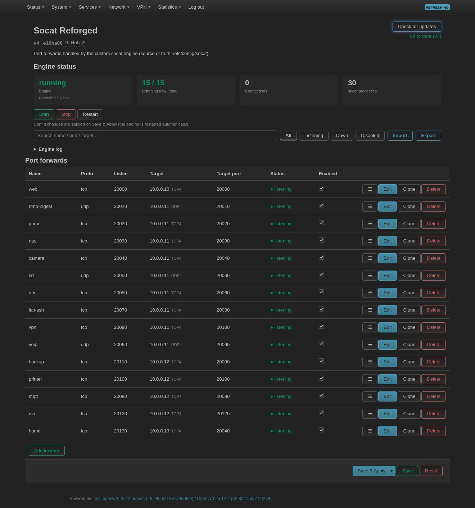

# luci-app-socat-reforged

> ### ⚠️ Early development — expect bugs
>
> This app is young and moves fast. The engine, the packaging and the interface
> all change between releases, and defects keep turning up — several of them only
> on a real router (a different `socat` build, BusyBox `awk` reading a padded
> port as octal, IPv6 corners that only some socat versions have). It runs every
> day on the author's own router, but treat it as **beta**:
>
> * keep a copy of `/etc/config/socat` and of your firewall config before
>   upgrading, and read `CHANGELOG.md` first;
> * a bug report is much more useful with the output of
>   `logread -e socat-boot` and `socat -V` (the `socat` build decides what some
>   rules can do at all — TLS needs OpenSSL, which the stock OpenWrt package
>   does not have);
> * nothing here is guaranteed; if a forward matters to you, test it after
>   every upgrade.

A **from-scratch ("reforged") socat port-forward manager for the modern LuCI**
(ucode / JavaScript), for **OpenWrt 24.10 and newer** — including **25.10+**,
where the classic Lua/CBI LuCI (and `luci-compat`) no longer exists.

Existing socat LuCI apps (`chenmozhijin/luci-app-socat`, `big-tooth/luci-app-socatg`)
are written for the old Lua/CBI LuCI and **do not run on the new LuCI**. This is a
drop-in replacement with a modern, ucode-native view.



## Features

* **Modern LuCI view** (`form.GridSection`, no Lua runtime): an editable
  port-forward table with live listener status, a **search box** and
  **status filters** (all / listening / down / disabled), and a friendly
  empty state.
* **Port ranges**: `listen_port` accepts `30000-30010` as well as a single
  port — the engine starts (and reports) one listener per port, aggregates the
  firewall rule, and caps a range at 256 ports so a typo cannot fork thousands
  of workers.
* **rpcd / ucode backend** (ubus object `luci.socat-reforged`): the page does
  **not** shell out from the browser. One RPC returns the whole state
  (engine, every rule, active connection counts) and the actions run
  server-side — faster, no `netstat`/`ps` parsing, and the ACL grants only
  the exact methods.
* **Engine status card**: running/stopped (+ *last reconcile* age),
  `listening / total`, **live connection count**, worker count, and
  **Start / Stop / Restart** buttons.
* **Per-rule reload** — `Save & Apply` restarts **only the rule(s) you changed**
  (a diff/reconcile engine, not a blunt restart); a **Restart this rule**
  button does the same for a single rule on demand.
* **Live status per rule** (`● listening` / `○ down` / `○ disabled`) plus the
  active connection count, refreshed automatically; **inline enable checkbox**
  that applies on `Save & Apply`.
* **Reachability test** per rule (dials the configured target — optionally via
  the configured proxy; bounded by `connect-timeout=5` so a black-holed target
  cannot hang the request) and **Clone** to duplicate a rule.
* **Import / export** all rules as JSON.
* **Check for updates / update now**: the page asks the GitHub release API *from
  the router* (so it works even when the browser cannot reach GitHub), shows the
  release notes and installs the matching `.apk`/`.ipk` — plus the Chinese
  language package when it is installed — with the system package manager.  The
  answer is cached for six hours; `Engine settings → Look for new versions` (off
  by default) makes the page check on its own when you open it and put a notice at
  the top.  Nothing is downloaded or installed until you press the button.
* **Port-conflict detection**: two enabled rules sharing a `proto:port` are
  flagged in the table and in a warning banner.
* **Down-reason reporting**: a rule that cannot start shows the listener's own
  error (e.g. `address already in use`) in the table and in a warning banner, and
  half-bound rules (e.g. IPv4 up, IPv6 refused) show as `partial`.
* **Unsaved-changes guard**: red banner + a save/discard dialog when you leave
  the page with pending edits (banner clears the moment you revert a value).
* **Automatic WAN firewall** (`firewall_accept`, on by default): keeps a dedicated
  `socat-reforged` accept rule in sync with your rules, validated before reload and
  persisted in `/etc/config/firewall`.
* **IPv6-aware**: listens on IPv4 + IPv6 by default (bind to the live WAN v6), with
  an optional IPv4-only / IPv6-only per rule.
* **Reach the target through a proxy** (SOCKS4a / HTTP CONNECT) per rule.
* **Standalone / self-healing**: the engine loop reconciles against the running
  workers every cycle (and on demand), fixes the WAN IPv6 default route, re-checks
  the WG DNAT rule and exercises the hardware watchdog. A **single-instance lock**
  guarantees only ever *one* engine loop reconciles — even if a competing init
  (e.g. a socat build shipping its own init for this engine) is present, the extra
  loop just idles, and the lock self-heals if the holder dies uncleanly.
* **Event-driven**: a hotplug hook reconciles the engine when an interface comes
  up, goes down or changes address, so a PPPoE redial or DHCP renew is applied
  in seconds instead of waiting up to one cycle.
* **Theme-aware** UI (uses the LuCI CSS variables, so light and dark themes both
  look right).

## Requirements

* OpenWrt **24.10+** with the **JavaScript LuCI** (default in 24.10; the only one
  in 25.10+). No `luci-compat` needed.
* `socat` (pulled automatically as a dependency; it is architecture-specific and
  comes from your distribution's feeds).
* **The forwarding engine is included.** The package ships `/etc/socat-boot.sh`,
  its config generator `/usr/libexec/socat-reforged-gen.awk` and its own procd
  service `/etc/init.d/socat-reforged` — no separate engine is needed. On install
  it stops and removes any legacy init that runs the same engine (e.g. from a
  custom socat build) so only one loop can ever run.
* A `firewall4`/`nftables` system for the automatic WAN rule (everything else works
  without it; the firewall sync simply no-ops).
* BusyBox userland (standard on OpenWrt) for `sh`, `awk`, `sort`, `grep`, `tr`,
  `sed`, `awk`, `pgrep`, `killall`, `ubus`, `uci`, `logger`.
* For the built-in updater: a route from the **router** to `api.github.com` and a
  downloader (`uclient-fetch` is a package dependency; `curl` and `wget` are
  fallbacks), plus the CA bundle for certificate verification. Only the
  "Check for updates" button needs this — everything else works offline.

## Engine settings (UCI section `socat.reforged`, editable in the UI)

| option | default | meaning |
| --- | --- | --- |
| `debug` | `0` | Log a `HEALTH` line every minute (memory, worker count, IPv6, uptime). |
| `update_check` | `0` | Ask GitHub for the latest release when the page is opened (and every six hours while it stays open) and show a notice when there is one. Nothing is downloaded or installed until you press **Update now** yourself. |

Runtime state lives in `/var/run/socat-reforged/` (`desired`, `state`, `fw.sig`, `fw.zones`,
`err/<kind>-<port>.log`, `ratelog/`), the heartbeat in `/var/run/socat-reforged.hb`.
`socat-boot.sh status` prints a human-readable summary.

## What the engine works out for itself

Nothing about your WAN is hard-coded — all of it is discovered each cycle, so
the package behaves the same on any OpenWrt layout:

| what | how it is detected |
| --- | --- |
| WAN device | the device carrying the default IPv4 route (falling back to IPv6) — `eth0`, `eth0.2`, `pppoe-wan`, `wwan0`, `wlan0`, … |
| WAN IPv6 address | the global address of that device (falling back to any global, non-link-local, non-ULA address) |
| **no IPv6** | IPv6 listeners are simply omitted; every IPv4 forward still runs (this is logged once, not every 30s) |
| firewall zone(s) | the `firewall` zone(s) whose `network`/`device` list covers that device (named *or* anonymous zones, multi-WAN gets one rule per zone) |
| unknown firewall layout | the engine refuses to guess: it logs once and leaves your firewall alone instead of writing a rule into a non-existent zone |
| socat binary | `/usr/bin/socat`, else `command -v socat` |
| fw4 | only when `/sbin/fw4` exists; otherwise the firewall sync is a no-op |

The generated accept rules use fw4's default `family`, so both the IPv4 and the
IPv6 side of a zone are covered by the same rule.

Verified against these layouts: DHCP on `eth0.2` (default zone), PPPoE on
`pppoe-wan`, a renamed zone (`ext`), a device-only zone, multi-WAN (two zones
for the same device), a router with no IPv6 at all, an anonymous zone that
cannot be referenced by a rule, and a layout that cannot be mapped to a zone
(no rules written, one warning).

The engine also fixes its own `PATH` and resolves every tool it uses
(`ip`, `uci`, `awk`, `nft`, `fw4`, `pgrep`, `logger`, `socat`, …) once at
startup, so it behaves the same whether it was started by procd, by the
ucitrack trigger, from cron or by hand with a minimal environment. If `awk` or
`uci` are missing it logs once and does nothing at all rather than treating
that as "all rules disabled" (which would have stopped every forward).

## How it works (short version)

* **Protocol coverage**: TCP/UDP on IPv4 and IPv6, **TLS** (`OPENSSL-LISTEN`
  with your certificate, `OPENSSL` dial with optional CA verification),
  **Unix sockets** on either end, and **multicast** — join a group on the
  listen side (`ip-add-membership`) and relay it to a unicast target, a
  different group (`ip-multicast-if`/`-ttl`/`-loop`) or a TCP target. IGMP is
  accepted on
  WAN zones while a multicast rule is active.
  **TLS needs a socat built with OpenSSL.** The `socat` package that ships with
  OpenWrt is built with `--disable-openssl`, so `socat -V` prints
  `#undef WITH_OPENSSL` and a TLS rule cannot start — it is reported **down**
  with socat's own message (`unknown device/address "OPENSSL-LISTEN"`, which is
  exactly what you get). Check with `socat -V` before blaming the rule.
  Other IPv6 limits that are enforced rather than silently ignored: an IPv6
  target needs `dest_proto` tcp6/udp6/tls (a v6 literal in a v4 address is
  accepted by socat at bind time and then fails on every connection), a proxy
  server cannot be an IPv6 address (`SOCKS4A:`/`PROXY:` cannot express one),
  multicast is receive-side IPv4 only, and `listen_addr` is ignored on an
  IPv6 UDP listener (socat refuses `bind=` there). Each of those is reported as
  a warning or a skipped rule instead of a listener that cannot work.
  **TLS also listens on IPv4 only**: socat has no IPv6-capable OpenSSL listener
  (every `bind=` form fails with `getaddrinfo ... Address family for hostname
  not supported`, and with no `bind=` it binds IPv4 only — on 1.7.4/1.8.1; 1.8.0.0
  would bind the whole IPv6 wildcard, so the generator pins `pf=ip4` and the rule
  stays IPv4-only there too). A TLS rule left on
  the default family therefore listens on IPv4, says so in the log, and a rule
  set to *IPv6 only* is skipped rather than starting a listener that would die.
* **Socket options** per rule: `TCP_NODELAY`, listen backlog, `max_children`,
  reuse-address, transfer timeout (`socat -T`), TCP `keepalive` (on by default;
  turn it off for a target that never closes its side), binding the listener to
  one local address (`bind=`) and `system_log` (route that rule's socat log to
  syslog via `socat -ls -d`).
* **Process + connection options** per rule: `user` (the accepted connections
  run as that user — privileges drop after the socket is open, so a low port
  still works) and `retry` (keep dialling a target that is not up yet instead
  of dropping the connection). `retry` is offered for TCP, TLS and unix targets
  only: socat rejects it on a UDP address.


* The LuCI view talks to the ubus object `luci.socat-reforged`; one call returns
  engine state, every rule's live status, connection counts and — new — **why a
  rule is down** (the listener's own error message).
* The engine parses `/etc/config/socat` with **one** `uci show` + **one** awk
  pass per cycle into `/var/run/socat-reforged/desired`; validation (port ranges,
  IP/hostname whitelist, family, proxy) happens there, so a bad value can never
  become a broken command line.
* Every worker it starts carries `SOCAT_REFORGED=1` in its environment, so the
  engine only ever manages **its own** socat processes — a socat you started
  yourself is left alone.
* Reconcile is a diff: unchanged rules keep running, only changed rules restart.
  IPv6 is read from the interface that holds the default route, and with no IPv6
  at all the engine still starts every IPv4 forward.

## Installation

### 1. Manual install (any architecture)

The package is shell + JavaScript + JSON + ucode — **architecture-independent**.
If you can copy files to your router you can install it, no compilation:

```sh
# on the router (adjust the source dir)
tar -xzf luci-app-socat-reforged-<ver>.tar.gz
cd luci-app-socat-reforged-<ver>
sh install.sh
```

`install.sh` installs the UI, the rpcd backend, the **engine** and its **procd
service**, creates `/etc/config/socat` if missing, and migrates off a legacy
engine init. It is idempotent, backs up before touching the engine, and never
overwrites your existing `/etc/config/socat`.


`uninstall.sh [--purge]` stops the engine, removes the package files and the
firewall rules it created, and **keeps** `/etc/config/socat` (your forwarding
rules) unless you pass `--purge`.

The engine is managed as the procd service **`socat-reforged`**:

```sh
/etc/init.d/socat-reforged enable     # start at boot
/etc/init.d/socat-reforged start
/etc/init.d/socat-reforged stop
```

### 3. Prebuilt packages

CI can produce `luci-app-socat-reforged_*` packages (see `.github/workflows/build.yml`
and the Releases page). Because the package is `Architecture: all`, **a single
build works on every OpenWrt architecture** — only the `socat` dependency is
per-architecture and is resolved from your own feeds.

**After upgrading, hard-refresh the browser** (Ctrl+Shift+R). LuCI serves the
view's JavaScript under a version key that only changes with `luci-base`, so a
cached copy of the old page keeps running until you force a reload — a fresh
install usually looks unchanged until you do.

The page can also do this for you: **Check for updates** (next to the version at
the top) asks the GitHub release API from the router, shows the release notes and
installs the new package with `apk`/`opkg` when you press **Update now**. Turn on
*Engine settings → Look for new versions* to have the page check by itself and
show a notice at the top. The check needs a route from the **router** to
`api.github.com`; the download goes through `uclient-fetch` (a dependency of this
package; `curl`/`wget` are used as fallbacks) with certificate verification on, so
`ca-bundle` must be installed. The engine restarts while the package installs,
which interrupts active forwards for a few seconds.

### 4. Translations

Translations ship as **separate language packages** (the LuCI convention):
`po/<lang>/` in this repository is compiled by `luci.mk` into
`luci-i18n-socat-reforged-<locale>`, so installing one does not touch the app
package. Simplified Chinese is included — the catalogue lives in `po/zh_Hans/`
and the package is `luci-i18n-socat-reforged-zh-cn` (LuCI names the package after
the locale alias, not the directory). The interface falls back to
English for anything a catalogue does not cover. The backend's own error strings
(the `Test` button, the log) are mapped onto translatable messages in the view,
and `tests/host/view-smoke.js` keeps that mapping and the backend in sync.

The prebuilt language package is attached to the Releases next to the app
package (`apk add --allow-untrusted ./luci-i18n-socat-reforged-zh-cn-*.apk`, or
`opkg install` the `.ipk`). It **depends on the app package**, so install that
first — and note that a hand-installed tree (`install.sh`) is not a package, so
the language package will refuse to install until you install the `.apk`/`.ipk`
itself. After installing a language, pick it in *System → System → Language and
Style* and hard-refresh the browser.

## How different architectures are handled

* **This app is architecture-independent.** `LUCI_PKGARCH:=all`; the payload is
  `sh` + `.js` + `.json` only. One `_all` package (or the source tarball) installs
  on x86-64, aarch64, arm, mips, RISC-V, … alike.
* **`socat` is the only arch-specific piece**, and it is a normal dependency:
  `apk add socat` / `opkg install socat` picks the right build for your target.
* **No per-architecture build of this package is needed.** If you build from source,
  any target's SDK produces the same `_all` package. If you use CI, a single matrix
  entry is enough; extra entries only validate more targets.
* **Manual install needs no compilation at all** — ideal for tiny/exotic devices.

## Repository layout

The package follows the LuCI buildroot convention (`luci.mk` installs `root/`
into `/`, `htdocs/` into `/www`); the engine and its service are part of the
package:

```
root/…   -> /      (menu, ACL, ucitrack, engine + init, libexec helpers,
                    rpcd/ucode backend)
htdocs/… -> /www   (the LuCI view)
```

## Configuration (UCI: `/etc/config/socat`)

Each `config config` section is one forward:

| option | meaning |
| --- | --- |
| `enable` | `1`/`0` |
| `remarks` | label |
| `proto` | `tcp` / `udp` / `ssl` / `unix` |
| `listen_port` | WAN-side listen port (single port or `from-to`) |
| `dest_proto` | `tcp4` / `udp4` / `tcp6` / `udp6` / `ssl` / `unix` / `mcast` |
| `dest_ip` / `dest_port` | target |
| `family` | `''` = IPv4+IPv6, `4` = IPv4 only, `6` = IPv6 only |
| `proxy` | `''` / `socks4a` / `http` (+ `proxy_server`, `proxy_port`) |
| `firewall_accept` | `1` = keep the WAN port open automatically |
| `reuseaddr` | `1`/`0` (default `1`) |

## Tests

Everything that does not need a router runs anywhere (BusyBox/Linux + `socat`):

```sh
sh tests/run.sh                  # 8 suites: view, generator, zones, simulator, matrix, fuzz, engine keys, package layout
sh tests/run.sh --router router  # also install on a router, test engine/backend/perf
```

See `tests/README.md` for what each suite covers. Exit codes are CI-friendly.

Eight suites; five of them do not trust the string comparison:

* **layout simulator** — the real engine, the real `socat`, fake `uci`/`ip`: a
  full OpenWrt device in a sandbox, so reconcile, kill/respawn and the firewall
  rules are all exercised.
* **command matrix** — one rule per listener kind with every option on; each
  generated command is then started and its listener verified in
  `/proc/net/{tcp,tcp6,udp,udp6}` or as a unix socket file. This is the suite
  that catches "socat refuses this option on this address type", which the
  string-comparing tests cannot see.
* **fuzz** — ~100 hostile values (shell metacharacters, out-of-range and
  octal-looking numbers) fed to every option, asserting that the generator
  never starts a listener for a value it should have refused and that nothing
  it writes is a shell metacharacter.
* **engine keys** — derives the listener address types the *generator* can emit
  and asserts the engine's worker scan and its port/family classifier know every
  one of them, so a new listener type cannot be added without teaching the
  engine (an unknown kind is invisible: it is never stopped, restarted or
  counted).
* **package layout** — the thing users install: the executable bits (the engine,
  the procd init script and the ctl helper must be `0755` or the package installs
  a service that cannot start), the `root/`+`htdocs/` layout `luci.mk` expects,
  the package metadata variables, and the postinst *as make expands it* (a
  Makefile `define` turns `$$$(` into `$(` and eats a bare `$'`, which once
  shipped a postinst that was a syntax error).

The layout simulator is the one that matters for a generator change: the unit
tests compare the *generated key* (deliberately stripped of spaces) and only
match substrings, so a defect such as `UDP-LISTEN:53,forkUDP4:...`, `keepidle`
on a unix socket or `retry` on a UDP address is invisible to them — while the
simulator starts the real engine and the real `socat`, and the rule simply does
not come up. Always run it after touching the generator.

## Engine log

Every line the engine logs also goes to `/var/log/socat-reforged.log` — syslog's
ring buffer is small and is wiped on every reboot, so "what happened right
before it died" would otherwise be gone. The file is capped at 64 KiB (only the
newest half is kept), and `/var/log` is tmpfs, so it costs RAM, never flash.

Read it wherever you like:

```sh
tail -30 /var/log/socat-reforged.log
```

…or open the **Engine log** section at the bottom of the LuCI page: it shows the
last 300 lines (Refresh fetches again, Clear empties the file). The section only
talks to the router while it is open.

A healthy engine is silent while nothing changes, so it writes a rate-limited
`alive: workers=… listeners=… mem=…% uptime=…s` line about every 15 minutes —
that is the log's proof of life, not an error.

## Troubleshooting

`logread | grep socat-boot` is the first stop; common messages:

| message | meaning / fix |
| --- | --- |
| `WARN [<sid>] bad listen_port, skip` | A rule has a non-numeric or out-of-range port (1-65535). Fix it in the UI/UCI; the rule is ignored. |
| `WARN [<sid>] IPv6-only listen but no WAN IPv6 address` | The rule is `family=6` but the router has no global IPv6 right now; nothing is started until it does. |
| `reconcile: started=N stopped=M listeners=K` | Normal change log after Save & Apply. Repeated identical lines every cycle mean something is thrashing — check the state file. |
| `firewall: our accept rules are gone` | Someone removed the generated fw4 rules; they are recreated automatically. |
| `another engine loop (pid X) is active; idling this one` | A second loop tried to start; the singleton lock makes it idle until the active one exits. |
| rule shows `down` with `address already in use` | Another process holds that port — the table cell shows the exact error. |

Checklist when a forward does not work:
1. Is the rule **enabled** and shown as `listening`?
2. Is the listener really there: `socat-boot.sh status`
3. Is the WAN port open: `nft list chain inet fw4 input_wan | grep <port>` (or
   `uci show firewall | grep socat_reforged`)
4. Is the target reachable from the router: the **Test target** button, or
   `socat -T3 -u /dev/null TCP4:<ip>:<port>`

## Credits & license

GPL-3.0-or-later. See `NOTICE` for prior art and the `socat` runtime dependency
(GPL-2.0). This is an independent reimplementation; no code was copied from the
older Lua apps.
